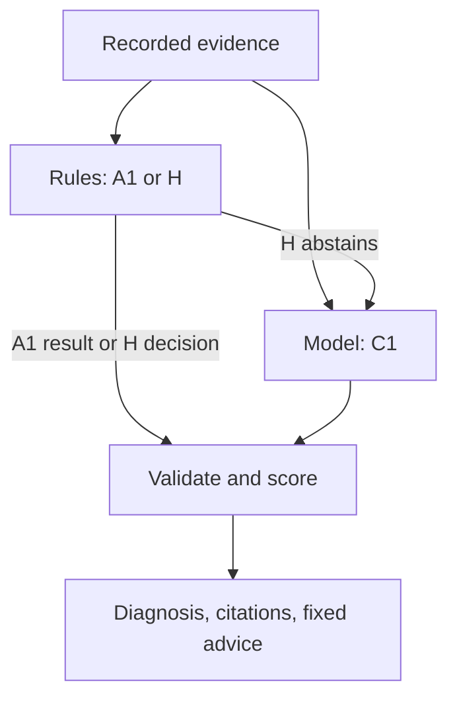

# AKS Readiness Diagnostic Agent

**A read-only Kubernetes readiness diagnostic experiment, validated on kind. AKS validation is pending.**

I compare explicit rules (A1), one model request (C1), and a rules-to-model cascade (H) on exactly the same recorded evidence. The question is whether a model improves diagnosis or explanation enough to justify its latency, cost and failure modes. Recommendations are displayed as text and never executed.

| Development pilot | Correct attempts | Provider failures | Model calls |
| --- | ---: | ---: | ---: |
| A1 — rules | 24/24 | 0 | 0 |
| C1 — gpt-4.1-nano | 9/24 | 10 | 24 |
| H — cascade | 24/24 | 0 | 0 |

Eight instrumented Uvicorn/Go cases, three repetitions each. **These results do not establish that rules outperform LLMs generally.** A1 was developed against these lab patterns. H never reached the model. Ten C1 requests failed without preserved HTTP details; missing Go answers cannot be attributed to model quality. There is no independent held-out result.

[Original pilot and provenance](eval/2026-11-05-kind-paired) · [Post-hoc citation review](eval/2026-11-05-kind-paired/rubric-v2) · [Current status](docs/status.md)

## Diagnostic flow



Evidence and ground-truth labels stay separate. Scoring distinguishes cause correctness and citation coverage; a valid evidence ID alone does not prove semantic support. Provider failures stay in the denominator. Repetitions measure consistency, while paired comparisons use eight cases, not 24 independent samples.

## Replay without a cluster or model

Python 3.11+. From the repository root:

```bash
python -m pip install -e .
python -m unittest discover -s tests -v
python tools/run_local_lab.py pilot --cases data/recorded-dev/2026-11-02-kind --output .local/runs/a1-replay --variants A1 --repetitions 3
```

Use a new output directory each time. This makes no model requests. Eighteen additional fixtures under `data/dev` are synthetic regression examples, not independent validation.

## Citation review: preserve the original result

R003's access log contains both the registered readiness route and the failing 404 request. The original rubric unnecessarily also required the Event ID. A documented post-hoc rubric revision accepts `probe` plus `logs` or `startup` for this case. Rescoring the saved responses reduces the conservative C1 risk flags from six to three; cause accuracy and provider errors are unchanged. This is a development correction after observing outputs, not preregistered confirmation.

```bash
python tools/rescore_recorded_pilot.py --output .local/review/rubric-v2.json
```

The original evidence, labels and result files remain unchanged. New model recommendations use fixed, read-only templates, while dynamic strict schemas restrict citation IDs to the current bundle. Summary and uncertainty text remain untrusted model output.

## Next experiment

Record workloads with sparse/default logs and ambiguous controls; allow abstention when the evidence cannot identify a cause. Evaluate the cascade fallback with mocked tests first. Improve the rules and prompt fairly on development data, then freeze before independently prepared held-out data. No paid follow-up is part of the current checks.

## Run and inspect

- [Local recorder and cleanup](docs/local-lab.md): dedicated kind lab, not Azure provisioning.
- [Usage and provider configuration](docs/usage.md): paid calls require an explicit flag.
- [Evaluation and freeze](docs/evaluation.md): code hashes normalize Python line endings; dataset bytes remain exact. Python patch versions stay strict.
- [Security](docs/security.md): collector RBAC, CodeQL, Trivy and authorization checks.
- [GitHub recording workflow](docs/github-actions-pilot.md): eight real development recordings and A1 replay.

## Boundaries

The collector reads named Pods, Events and logs; it does not read Secret objects or mutate workloads. It uses the credentials of the explicitly selected kubeconfig context; restricted RBAC requires a dedicated identity. Review logs before provider submission: pattern-based redaction is incomplete, and prompt-injection resistance is not established. The adapter has no automatic retries. Entra model authentication, temporally aware evidence, built-image scanning and live AKS validation remain pending. A green pipeline does not establish production readiness.
